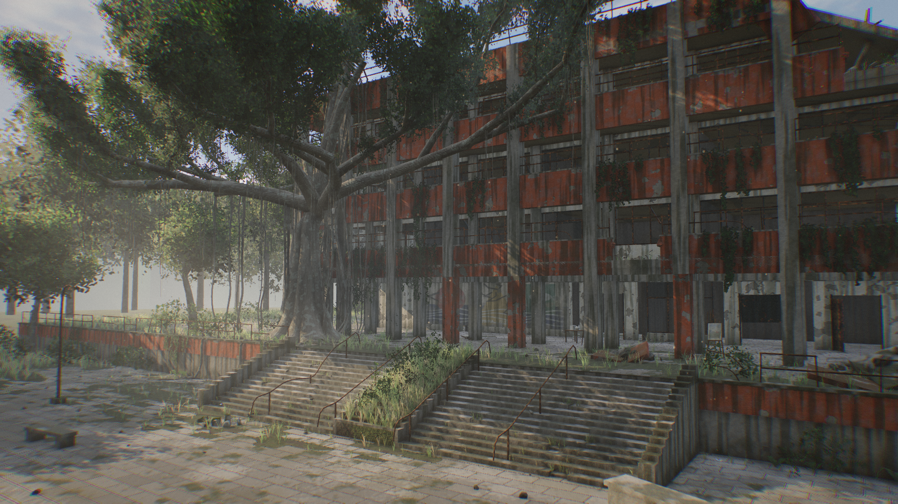

# 广州美术学院 · 人类消失后第 50 年

Three.js（r186）实时场景：大学城校区一栋外廊式教学楼，被一棵大榕树慢慢吞没。所有几何、贴图都由代码程序化生成，没有外部模型或图片。



## 运行

```bash
npm install
npm run dev
```

打开 http://localhost:5173（或终端里显示的端口）。生产构建：`npm run build`，产物在 `dist/`。

操作：拖动环视 · 滚轮推拉 · 右键平移 · `C` 自动巡游 · `H` 隐藏界面

## 场景里有什么

- **教学楼**：架空层 + 三层外廊，橙色涂装栏板剥落、水渍、苔藓；钢窗破碎（残片 / 完整 / 推开的窗扇），右端屋面塌落，钢筋外露；二层栏板被榕树枝顶破。
- **榕树**：九股绞合主干、板根漫过挡土墙、成片垂下的气根（部分落地成支柱根），沿立面攀附的绞杀根，粗枝伸进二层走廊。
- **植被**（克制，参考《最后生还者》）：砖缝草、破损地砖里的草丛、台阶后缘的草、蕨类、灌木、栏板垂挂与柱身攀爬的藤蔓、落叶。
- **美院细节**：首层学生壁画、架空层里的画架与静物台、散落在草里的石膏几何体、倒伏的共享单车、校名墙（“学”字歪挂、“院”字掉落留下印痕）。
- **生灵**：盘旋的鸟群、蝴蝶、只在阳光里可见的浮尘。

## 渲染

- 自定义后期管线（`src/post.js`）：4×MSAA HDR → 半分辨率 SAO 环境光遮蔽 → **沿视线采样太阳阴影图的体积光**（树冠下的光柱、高度雾 + 局部晨雾）→ 深度感知模糊与联合双边上采样 → Bloom → 调色 + ACES + 暗角 + 颗粒。
- 风化材质（`src/materials.js`）：世界空间三平面噪声，统一处理混凝土 / 油漆剥落 / 锈铁 / 树皮 / 花岗岩地砖 / 泥土 / 木头，含苔藓、水渍、底部污垢和程序化凹凸。
- 植被：实例化叶片卡 + 风动 + 球面法线 + 阴影图透光；叶片贴图使用**保持 alpha 覆盖率的 mipmap**，远处不变稀、不闪。
- 窄屏 / 竖屏会自动加宽视角；前 120 帧低于约 40fps 时自动降低渲染分辨率。

## 目录

| 文件 | 内容 |
| --- | --- |
| `src/layout.js` | 场地尺寸常量（平台、台阶、柱网） |
| `src/building.js` | 教学楼、平台、台阶、广场小品 |
| `src/banyan.js` | 榕树生成 |
| `src/vegetation.js` | 草、蕨、灌木、藤蔓、背景树、落叶 |
| `src/props.js` | 碎石、画架、石膏体、单车、路灯、校名墙 |
| `src/textures.js` | 程序化贴图（噪声、叶簇、壁画、油画、校名字） |
| `src/materials.js` | 风化材质 / 植被材质 |
| `src/sky.js` · `src/life.js` · `src/post.js` | 天空与 IBL · 鸟 / 蝴蝶 / 浮尘 · 后期 |

开发服务器下可在控制台调用 `__shot('name', 1920, 1080)`，把当前视角渲染成 PNG 存到 `shots/`。
